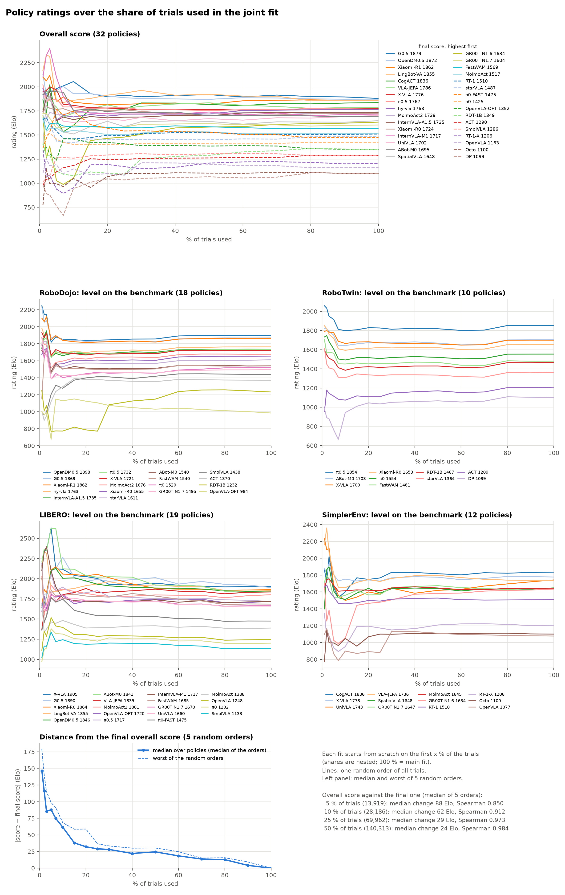

# How the RoboElo score is computed

This document walks through the computation in order. For each step it explains what is done, why, which alternatives were considered, and what the choice costs.

- **The ratings themselves** are in [ratings/](../ratings/README.md).
- **Where the numbers come from:** examples and evidence are computed on the milestone policies in this repository's data (leaderboard snapshots of 2026-10-24).

---

## 0. The idea: a statistical model, reported in Elo units

The score is **not** updated match by match like chess Elo. It is a parameter of a statistical model, an item-response-theory (IRT) model:

```
successes per policy × task  →  one joint fit  →  fix the scale  →  average into an overall score
```

**Why not classic Elo.**

| Classic Elo | Our data |
|---|---|
| Updates after every game | Batch counts, such as "policy m succeeded k of n times on task t" |
| Result depends on the order of games and on a K-factor | Has no natural order |

AGI-Elo (Sun et al., NeurIPS 2025) treats policies and test cases as the two sides of a game. Mathematically that is a Rasch / IRT model, so we estimate it directly from all data at once. This has three benefits:
- the result does not depend on any order;
- all information is used;
- uncertainty can be estimated.

**What we keep from Elo is only the scale.** A rating gap of 400 points means 10 : 1 odds, and the scale is centred at 1500. This choice of unit makes numbers easy to read and carries no statistical assumption.

---

## 1. Data

### 1.1 One cell = one policy on one task: k successes in n trials

**We use counts, not success rates.** 25 of 50 and 75 of 150 are both 50 %, but the second is much more certain. A binomial likelihood on counts gives cells with more trials more weight automatically.

**We work at the level of tasks, not benchmark averages.**
- Tasks differ greatly in difficulty.
- Policies often run different subsets of tasks, and averages over different subsets cannot be compared.
- With per-task data the model estimates each task's difficulty along the way, which removes the effect of which tasks a policy happened to run.

### 1.2 Trials per cell

**The problem.** RoboDojo's leaderboard reports success rates averaged over training seeds, usually 3 seeds × 50 (or 25 + 25) episodes. The "n" shown on the website is the number of episodes per seed, not the number of trials behind the reported rate.

**What we do.** We infer the seed count per policy from the granularity of its success rates. For example, 0.67 % = 1/150 means 3 × 50 episodes. Most policies come out at 3 seeds; a few come out at 1, 2 or 4.

**Known cost.** Three training seeds are not independent repetitions: different seeds give genuinely different policies. Treating 150 episodes as 150 independent Bernoulli trials overstates how precise a RoboDojo cell is. A beta-binomial likelihood would address this.

**Other benchmarks:**

| Benchmark | Trials per cell |
|---|---|
| RoboTwin 2.0 | 100 |
| LIBERO | 50 (fixed initial states 0–49) |
| SimplerEnv | the number of episodes in the official evaluation scripts |

### 1.3 What counts as one task (test case)

**Principle: split when difficulty clearly differs.** Every extra test case is one more difficulty that the model estimates separately.

- **RoboDojo** standard and randomized variants are separate test cases.
- **RoboTwin 2.0** clean and randomized are separate test cases.
  - Perturbations change difficulty a lot.
- **SimplerEnv's "pick coke can"** is split by orientation: horizontal, vertical, upright.
  - The orientations differ in difficulty.
  - The SimplerEnv paper reports them separately, so our numbers can be checked against it.

### 1.4 Linking policies across benchmarks

**The same policy appearing on two benchmarks is the only thing that ties the benchmarks to one scale.** Each policy therefore gets one name across benchmarks.

**A wrong link is worse than no link.** A false link transfers one policy's ability to another benchmark and shifts that whole benchmark. So links that cannot be verified are left out. Example: RoboTwin's "GalaxeaVLA" entry does not name the Galaxea model. It is linked to RoboDojo's "GalaxeaVLA (G0)" because XPolicyLab, which produces both leaderboards, runs GalaxeaVLA as the G0 line and G0.5 as a separate policy ([data/README.md](../data/README.md#policy-names)). For the same reason our three starVLA LIBERO runs are left out: RoboDojo's "starVLA" entry is StarVLA-alpha, a different model, and RoboTwin's "starVLA" entry does not name its variant. DM0.5's LIBERO run (lerobot/dm05_libero) is linked to RoboDojo's DM0.5 entry, not to its DM0 entry.

**Benchmark-specific fine-tunes count as the same policy.** Examples are OpenVLA-OFT's LIBERO checkpoint or X-VLA's per-benchmark checkpoints. The advantage a fine-tune brings is absorbed by the offset γ (section 2.2).

**So a "policy" is a model recipe, not one checkpoint.** Almost every link between benchmarks joins checkpoints trained differently: RoboDojo and RoboTwin 2.0 entries are trained on their own benchmark's data, and most LIBERO and SimplerEnv checkpoints are fine-tuned for that benchmark. A policy's rating therefore describes a model family (architecture and pre-training) fine-tuned the way each benchmark expects. It does not describe the general robot ability of any single checkpoint. How much a fine-tune changes a policy is visible in its offsets, and the linking test (section 8) shows where it breaks the transfer between benchmarks.

### 1.5 Which policies are fitted

**Only the milestone policies** ([data/milestone_policies.csv](../data/milestone_policies.csv)) that have results on RoboDojo, RoboTwin 2.0, LIBERO or SimplerEnv: 32 of the 34. ECoT and GR00T N1.5 have no results yet. The other leaderboard entries in data/ are left out of the fit.

**Why.** The ratings are reported for these policies. A fit of these policies alone defines their scale by them alone: a leaderboard entry that is added or withdrawn does not move their scores.

**Cost.** Each test case is estimated from fewer policies: 16–18 on RoboDojo, 10 on RoboTwin, 18–19 on LIBERO and 10–11 on SimplerEnv. Task difficulties are therefore less precise (section 8.5).

**How much it changes the scores.** With the same configuration (σ_γ = 1, σ_β = 4 logits, one conversion factor per setting), fitting the milestone policies alone instead of all 95 policies in data/ changes their overall scores by a median of 12 Elo (largest change: Octo, 58 Elo; Spearman ρ = 0.992).

`ROBOELO_POLICIES=all` fits every policy instead.

---

## 2. The model

```
log( P / (1 − P) ) = a_s × ( μ_m + γ_m,s − β_t ) / 173.72
```

| Symbol | Meaning |
|---|---|
| P | chance that policy m succeeds on test case t |
| μ_m | the policy's general ability |
| γ_m,s | the policy's offset on setting s: how much stronger or weaker it is there than μ suggests |
| β_t | the test case's difficulty: the level that gives a 50 % chance of success |
| a_s | conversion factor of setting s: how strongly a rating gap turns into success there |
| 173.72 | 400 / ln 10, so that with a = 1 a 400-point advantage means 10 : 1 odds |

In Elo form, with level = μ_m + γ_m,s:

```
P = 1 / (1 + 10^( −a_s × (level − β_t) / 400 ))
```

### 2.1 Success depends only on the gap "level − difficulty"

**Why.** This is the common core of Elo and the Rasch model.
- Policies and tasks sit on the same axis.
- A task's difficulty has a direct meaning: the rating a policy needs for a 50 % chance.
- This is what lets everything be drawn on one Wright map.

**The constant 173.72** is only a change of units.

### 2.2 Why the offset γ

**The problem.** Policies are often fine-tuned for one benchmark. OpenVLA-OFT succeeds on 97 % of LIBERO episodes and almost never on RoboDojo.

**What happens without γ.** A single μ would have to explain both "very strong" and "very weak". The fit would be poor on both benchmarks. Worse, the conflict would leak into the task difficulties and distort other policies' ratings.

**What γ does.** It says "on this setting, this policy is this much better or worse than its general ability". In IRT this is a *testlet effect* (Bradlow, Wainer & Wang, 1999).

### 2.3 Why a conversion factor a

**Why.** The same 100-point gap changes success rates by different amounts on different benchmarks, because some benchmarks discriminate more sharply than others. In IRT this is the discrimination parameter of a 2PL model.

**In the fit the factors differ widely,** from about 0.8 to 1.5 (section 7).

**What the evidence says.**
- **Within a benchmark, separate factors don't matter.** With random cells hidden, they predict as well as one shared factor (Appendix A.3), because each policy's offset on a setting can absorb most of the difference.
- **Where they matter is across benchmarks:** when a policy's results on one benchmark are predicted from its other benchmarks. In the linking test (section 8.1), one factor per benchmark predicts best (mean log loss 0.3896), one per setting is close (0.3900), and one shared factor is worse (0.3950). The fit therefore uses one factor per benchmark.

**Why not one a per task (a full 2PL).**
- It would add about 200 parameters.
- Each task has results from only about 10–19 policies, which is too few to estimate its own discrimination reliably.
- One a per benchmark or setting is the compromise.

### 2.4 Why the offset γ is per setting

**What the settings are.** RoboTwin is split into clean and randomized; SimplerEnv into Google Robot and WidowX.

**Why split.** The randomized setting measures something else: robustness to perturbation. How much a policy's level drops from clean to randomized varies enormously. Drops relative to the average drop of the anchors (π0, π0.5, X-VLA, ACT; section 5.2):

| Policy | Drop from clean to randomized, relative to the anchors |
|---|---|
| π0.5 | −1.1 logits |
| X-VLA | 0.3 logits |
| ACT | 1.3 logits |
| FastWAM | 4.2 logits |

The standard deviation across the 10 policies on RoboTwin is 1.7 logits, about 300 Elo. One offset per benchmark cannot absorb that.

**Evidence.** Splitting lowers the held-out log loss from 0.3066 to 0.2975. All of the gain is on RoboTwin; on SimplerEnv one offset is slightly better ([Appendix A.1](#a1-offsets-per-setting)). Splitting also keeps policies whose levels on SimplerEnv's two robots differ by several hundred points from moving the whole benchmark (Appendix A.4).

**How the overall score handles settings.** The settings of a benchmark are averaged first (section 6). RoboTwin therefore does not count twice.

---

## 3. Priors (regularisation)

### 3.0 Why priors are needed at all

Pure maximum likelihood breaks in three places:
- **A task no policy solves:** its difficulty goes to +∞.
- **A policy that never succeeds:** its ability goes to −∞.
- **A policy seen on one benchmark only:** μ and γ appear only as the sum μ + γ, so they cannot be told apart.

Priors keep every estimate finite and let similar objects borrow strength from each other (partial pooling).

**Principle: the priors belong to the statistical model only and do not depend on the reference panel.** Section 5.1 explains why.

### 3.1 General ability: μ ~ N(m₀, σ_μ²), m₀ estimated freely

**What it does.** This is a weak prior, σ_μ = 2 logits ≈ 350 Elo. In practice it only matters for policies with no successes, or no failures, at all.

**Why m₀ is estimated.** Fixing m₀ to the panel's level would assume that the average policy is as strong as the reference panel, and would pull every policy towards the panel.

### 3.2 Offsets: γ ~ N(0, σ_γ²) — the knob for cross-benchmark transfer

**What σ_γ means.**

| σ_γ | Assumption | Effect |
|---|---|---|
| Small | a policy is about equally strong everywhere | information flows freely between benchmarks; a policy's levels are pulled together |
| Large | each benchmark stands on its own | almost nothing carries over between benchmarks |

**How σ_γ is chosen: by the linking test.** We hide all of one policy's results on one benchmark, predict them from its other benchmarks, and take the σ_γ that predicts best. How far ability carries over is an empirical question, so the data should answer it.

**Chosen value: σ_γ = 2 logits (≈ 347 Elo).** Best mean log loss of the linking test for each σ_γ (section 8.1):

| σ_γ (logits) | 0.25 | 0.5 | 1 | **2** |
|---|---|---|---|---|
| mean log loss | 0.4030 | 0.4000 | 0.3941 | **0.3896** |

2 logits is the largest value of the grid. Wider values, checked separately, predict worse: 0.3956 for 4 logits and 0.4063 for 8.

A smaller σ_γ pulls a policy's level on the hidden benchmark too close to its other levels; a larger one discards what its other benchmarks say.

**What the offsets shrink towards.** Towards the average offset of *all* policies on that setting, not the average of the reference panel. For a policy that never ran a benchmark, "it is probably like a typical policy there" is the natural statistical default. The reference panel only labels the scale.

### 3.3 Task difficulty: hierarchical prior β ~ N(group mean, σ_β²)

**The groups.**
- RoboDojo: capability dimension × variant.
- Other benchmarks: their own task groups, e.g. a LIBERO suite or a RoboTwin setting.
- The group means have only a weak prior.

**Why hierarchical.** Tasks in the same group tend to have similar difficulty. A task nobody solves is placed near "how hard tasks of its kind are", instead of being pushed to an arbitrary extreme by a wide flat prior.

**Cost.** If σ_β is too small, task difficulties are squeezed together, and that changes the conversion factor a.

**Evidence.** The prior on β moves the conversion factors ([Appendix A.2](#a2-the-prior-on-task-difficulty-moves-the-conversion-factors)). From σ_β = 0.5 to 8 logits, RoboDojo's factor falls from 2.17 to 1.52 and RoboTwin's from 1.30 to 0.90, while LIBERO's rises from 0.64 to 0.92 and SimplerEnv's from 0.56 to 0.79.

**Therefore:**
- σ_β is chosen by the linking test, the test that is sensitive to a. **Chosen value: σ_β = 8 logits (≈ 1390 Elo).** The test barely separates 4 and 8 logits:

  | σ_β (logits) | 0.5 | 1 | 2 | 4 | **8** |
  |---|---|---|---|---|---|
  | mean log loss | 0.3958 | 0.3971 | 0.3924 | 0.3901 | **0.3896** |

  8 logits is the largest value of the grid. Wider values, checked separately, predict worse: 0.3903 for 16 logits and 0.3918 for 32.
- Reports state that the conversion factors, RoboDojo's and SimplerEnv's most of all, depend on this prior.

**Why still hierarchical.** With a prior this wide, the hierarchy matters mainly for tasks that no policy, or every policy, solves. They are placed near their group's difficulty instead of at an arbitrary extreme.

### 3.4 Conversion factors: log a ~ N(0, σ_a²)

A mild prior that only stops a weakly linked benchmark's factor from running to extreme values.

---

## 4. The fit

**What is fitted.** All cells at once. The objective is the binomial negative log-likelihood of every cell plus the prior penalties.

**How.** It is minimised with L-BFGS-B (scipy) and the analytic gradient, which gives the maximum a posteriori (MAP) estimate. One fit of the 32 milestone policies takes a few seconds on one CPU core.

**Why MAP rather than full Bayesian sampling.** Speed. The bootstrap refits the model 1,000 times, and uncertainty comes from the bootstrap (section 8).

---

## 5. Fixing the scale (after the fit)

### 5.0 Why conventions are needed

Three changes leave every predicted success probability unchanged, so the data cannot decide them:

1. Add the same number to all offsets γ and all difficulties β of one setting.
2. Multiply all ratings by k and divide all conversion factors a by k.
3. Shift all ratings together.

Each of these has to be fixed by a convention.

### 5.1 Why the conventions are applied after the fit

**Principle: the reference panel only decides how the scale is labelled.** Changing the panel must not change any predicted success rate.

**What goes wrong otherwise.** If the conventions were written into the objective as penalty terms, the priors would be centred on the panel. Changing the panel would then change predictions too — in particular, how well a policy is predicted to do on a benchmark it never ran.

**What we do instead.** Fit first, then shift and rescale. Revising the panel later moves the scale but leaves every data-level conclusion intact.

**Policies that did not run a setting move with it.** In the fit, a policy without data on a setting has no offset of its own there. Its offset is the prior mean, that of a typical policy. The per-setting shift (section 5.2) therefore moves the offsets of *all* policies on the setting, including these, together with the setting's difficulties. Their predicted success on a benchmark they never ran is then what the fit implies, whatever the panel. `tests/test_unified.py` checks that the prediction for every cell, run or not, stays the same when the panel changes.

### 5.2 Per-setting shift: the mean offset of the informative reference policies is 0

**This is where cross-benchmark comparability comes from. It is the single most important assumption of the method.**

**What it says.** Each benchmark's tasks are placed so that the reference policies, on average, "perform as expected" there. In other words, the panel's mean level on the benchmark equals the panel's mean general ability.

**What it affects — and what it does not.**
- It does not change rankings within a benchmark.
- It does not change any prediction.
- It does decide how levels on different benchmarks line up. That in turn decides how policies that ran different benchmarks compare in their overall scores.

**No test can confirm it.** Because it changes no prediction, no comparison with data can show that it is right. The linking test (section 8) checks something else: whether a policy's results on other benchmarks predict its results on this one, i.e. whether there is an ability that carries over. That is necessary for comparing scores across benchmarks, but not sufficient. A level of 1800 on LIBERO and 1800 on RoboTwin are equal *by this convention*.

**Why anchor on reference policies rather than on one benchmark:**
- many policies never ran any single benchmark;
- anchoring on one benchmark makes every comparison pass through it, so the benchmarks are not treated symmetrically;
- reference policies are fixed, open and can be re-run by us, so the scale does not drift as new policies arrive.

**Why only informative reference policies.** A policy that is near 0 % or 100 % on almost every task of a benchmark tells us only "it is below (or above) all tasks". Its offset there is mostly set by the prior, and averaging it in would inject an arbitrary number into the scale.

"Informative" means that at least 25 % of its tasks lie strictly between 0 % and 100 %. On RoboDojo this leaves three anchors:

| Reference policy | Share of RoboDojo tasks strictly between 0 % and 100 % | Anchor? |
|---|---|---|
| π0.5 | 54 % | yes |
| X-VLA | 43 % | yes |
| π0 | 28 % | yes |
| SmolVLA | 22 % | no |
| GR00T N1.7 | 17 % | no |
| ACT | 9 % | no |
| OpenVLA-OFT | 2 % (mean success 0.00) | no |

**Cost.** Only three anchors remain on RoboDojo — the minimum we require.

**When fewer than three informative reference policies ran a setting,** the anchors are the first of these groups that has at least three members:
1. informative reference policies;
2. informative policies that also ran another benchmark;
3. informative policies;
4. every policy with data on the setting.

RoboTwin's clean and randomized settings, and SimplerEnv's Google Robot and WidowX, count as one benchmark here. The anchors on the current data:

| Setting | Anchors | Group |
|---|---|---|
| RoboDojo | π0, π0.5, X-VLA | 1 |
| LIBERO | π0, π0.5, GR00T N1.7, SmolVLA, OpenVLA-OFT, X-VLA | 1 |
| RoboTwin clean | π0, π0.5, X-VLA, ACT | 1 |
| RoboTwin randomized | π0, π0.5, X-VLA, ACT | 1 |
| SimplerEnv Google Robot | GR00T N1.7, X-VLA, MolmoAct, OpenVLA, VLA-JEPA | 2 |
| SimplerEnv WidowX | GR00T N1.7, X-VLA, OpenVLA, UniVLA, VLA-JEPA | 2 |

On SimplerEnv only two reference policies (GR00T N1.7 and X-VLA) have runs. Running more of the panel there would let SimplerEnv be anchored on reference policies alone.

**Possible refinement.** Weight each reference policy by the precision of its offset instead of using the hard 25 % cut-off.

### 5.3 The geometric mean of all conversion factors is 1

**Why.** It treats all benchmarks symmetrically. Setting one benchmark's factor to 1 would make that benchmark the centre of the scale.

**What it means.** On a "typical" benchmark, a 400-point gap is exactly 10 : 1 odds.

### 5.4 The reference panel's mean overall score is 1500

**Why the panel and not all policies.** With the mean of all policies, every strong new policy would push everyone else down. A fixed panel keeps existing scores stable.

**Why the overall score and not μ.** The overall score is the number we report, so "the panel averages 1500" can be read straight off the table.

### 5.5 The reference panel

**Members:** π0, π0.5, GR00T N1.7, SmolVLA, OpenVLA-OFT, X-VLA, ACT.

**Criteria:**
- open checkpoints we can run ourselves;
- a wide spread of strength, which the conversion factors need;
- presence on as many benchmarks as possible.

---

## 6. The overall score

```
level of policy m on setting s     = μ_m + γ_m,s
level of policy m on a benchmark   = mean of its levels over the settings of that benchmark it ran
overall score of policy m          = mean of its benchmark levels over the benchmarks it ran
```

**Why each benchmark counts once.**
- Weighting by tasks would let RoboTwin's 100 test cases outweigh LIBERO's 40.
- Weighting by trials would let RoboDojo dominate.
- "One benchmark, one vote" is the easiest to explain.

**Why not report μ.** How a level is split between μ and γ depends on the prior. For a policy seen on one benchmark the split is set entirely by the prior. The level μ + γ is what the data determines.

**Limitation.** The overall score depends on which benchmarks a policy ran. Example: policies A and B are equally strong on LIBERO, and only B also ran a benchmark where it is weaker. B's overall score is then lower, although nobody knows how A would have done there. For a policy seen on one benchmark only, any cross-benchmark comparison rests entirely on how well that benchmark is linked.

### 6.1 Two scores: measured benchmarks and full coverage

Every table therefore reports two scores side by side.

| Score | Definition | Interval |
|---|---|---|
| **Overall score** (measured) | mean of the policy's levels over the benchmarks it ran; the table lists those benchmarks | 2.5–97.5 % percentiles of the bootstrap |
| **Full-coverage score** | mean over all four benchmarks; a benchmark the policy did not run is filled with its predicted level μ + γ, where γ is the offset of a typical policy there; the table lists the predicted benchmarks | bootstrap spread plus the error of each predicted level |

**When a benchmark may be filled.** Only where the linking test shows that the prediction works *from the benchmarks this policy ran*. A benchmark the policy did not run is filled if at least one benchmark it did run predicts it in the single-source linking test (section 8.2): with at least five policies held out, the joint scale predicts their hidden results better than the task average of the other policies. A policy with a benchmark that cannot be filled this way gets no full-coverage score.

**Its interval.** The error of a predicted level is measured by the linking test: the root-mean-square difference, in Elo, between the level predicted for a held-out policy and the level it actually shows on the hidden benchmark (the 1-D maximum-likelihood level with that fit's task difficulties held fixed). For each predicted benchmark, (this error / 4)² is added to the bootstrap variance of the score; the interval is ± 1.96 standard deviations. Errors of different benchmarks are treated as independent.

**How to read the two.** The overall score says how a policy did where it was tested. The full-coverage score compares all policies on the same four benchmarks, at the price of a wider interval for policies with predicted benchmarks. Two policies whose full-coverage intervals overlap widely cannot be ranked.

---

## 7. Reading a score

The numbers below come from a fit with the current code on the data in this repository.

**π0.5's overall score.**
- Levels: RoboDojo 1732, LIBERO 1717, RoboTwin 1854.
- Overall score ≈ 1767, about 267 points above the reference-panel average.
- π0.5 has no SimplerEnv run. Its predicted SimplerEnv level is 1722, so its full-coverage score is (1732 + 1717 + 1854 + 1722) / 4 ≈ 1756.

**Predicted success on one task.** Take a RoboDojo task of median difficulty (β ≈ 2227); RoboDojo's conversion factor is a ≈ 1.52:

```
P = 1 / (1 + 10^( 1.52 × (2227 − 1732) / 400 )) ≈ 1.3 %
```

This is consistent with π0.5's mean RoboDojo success of 7 %, which also includes easier tasks.

**What +100 points means.** The odds of success are multiplied by 10^(a / 4):

| Where | a | Odds multiplied by |
|---|---|---|
| a "typical" benchmark | 1 | 1.78 |
| RoboDojo | ≈ 1.52 | 2.4 |
| LIBERO | ≈ 0.92 | 1.7 |
| RoboTwin | ≈ 0.90 | 1.7 |
| SimplerEnv | ≈ 0.79 | 1.6 |

**Task bars on the Wright map.** The bar from 25 % to 75 % success spans 2 · ln 3 · 173.72 / a ≈ 382 / a points. A longer bar means a less discriminating benchmark.

---

## 8. Uncertainty and checks

All checks are run by `scripts/run_unified_scale.py`; the command is given in brackets.

### 8.1 Linking test: hide one policy's whole benchmark (`linking`)

**What it does.** For every policy that ran at least two benchmarks, and every benchmark it ran: hide all its results on that benchmark, fit the rest, and predict the hidden results. 19 policies give 46 such pairs.

**What it is compared with.** The task average: the other policies' pooled success rate on the same test case. It knows nothing about the hidden policy, while the joint scale knows the policy's results on its other benchmarks. Both are scored by log loss per hidden trial; lower is better.

**What it chooses.** The test is repeated over a grid of 60 configurations: σ_γ ∈ {0.25, 0.5, 1, 2} logits, σ_β ∈ {0.5, 1, 2, 4, 8} logits, and one conversion factor per setting, per benchmark, or one shared factor. The configuration with the lowest mean over the four benchmarks of the log loss is used: **σ_γ = 2 logits, σ_β = 8 logits, one conversion factor per benchmark** (mean 0.3896). The surface is flat: the next two configurations are within 0.0005, and the tenth best is 0.3958. Both widths are the largest of the grid; wider ones, checked separately, predict worse (sections 3.2 and 3.3). Choosing the configuration on the same test that reports it makes the reported losses slightly optimistic; with differences this small, the effect is small.

**Result with the chosen configuration:**

| Hidden benchmark | Policies held out | Joint scale | Task average | Policies predicted better | Error of the predicted level |
|---|---|---|---|---|---|
| RoboDojo | 15 | **0.137** | 0.149 | 47 % | 252 Elo |
| RoboTwin | 9 | **0.505** | 0.527 | 78 % | 164 Elo |
| LIBERO | 16 | **0.267** | 0.280 | 75 % | 242 Elo |
| SimplerEnv | 6 | **0.649** | 0.658 | 50 % | 219 Elo |

The last column is the root-mean-square difference between the level predicted for the held-out policy and the level it shows on the hidden benchmark (section 6.1). On RoboDojo and SimplerEnv the pooled loss is lower, but only about half of the held-out policies are predicted better one by one.

**Where the transfer fails.** The largest misses, by how much worse than the task average they are predicted (total log loss), are policies much stronger or weaker on one benchmark than on their others, often because of a benchmark-specific fine-tune (section 1.4):

| Policy, hidden benchmark | Observed success | Predicted | Task average |
|---|---|---|---|
| π0, RoboTwin | 31.4 % | 21.1 % | 34.0 % |
| OpenVLA-OFT, LIBERO | 96.7 % | 73.9 % | 91.6 % |
| MolmoAct, SimplerEnv | 66.4 % | 40.1 % | 51.7 % |
| ABot-M0, RoboDojo | 1.9 % | 9.3 % | 5.6 % |

OpenVLA-OFT almost never succeeds on RoboDojo, but its LIBERO checkpoint is fine-tuned for LIBERO and nearly solves it. π0's weak LIBERO result (71.2 %) pulls its predicted RoboTwin level down.

**What it cannot show.** The per-setting anchoring (section 5.2) changes no prediction, so this test cannot confirm it.

### 8.2 Linking from one source benchmark (`sources`)

**What it does.** As in 8.1, but the held-out policy keeps only its results on one other benchmark, the source. This shows which benchmarks predict which.

| Source → hidden benchmark | Policies | Joint scale | Task average | Predicted better |
|---|---|---|---|---|
| RoboDojo → RoboTwin | 9 | **0.518** | 0.527 | 67 % |
| RoboTwin → RoboDojo | 9 | **0.100** | 0.109 | 67 % |
| LIBERO → SimplerEnv | 6 | **0.641** | 0.658 | 67 % |
| SimplerEnv → LIBERO | 6 | **0.247** | 0.279 | 83 % |
| RoboTwin → LIBERO | 6 | **0.230** | 0.239 | 83 % |
| RoboDojo → LIBERO | 12 | **0.254** | 0.258 | 83 % |
| LIBERO → RoboDojo | 12 | **0.153** | 0.163 | 58 % |
| LIBERO → RoboTwin | 6 | **0.563** | 0.571 | 83 % |

Links with fewer than five shared policies (RoboDojo, RoboTwin ↔ SimplerEnv) are left out.

**What the links show.** Every link with at least five shared policies predicts better than the task average, including those between LIBERO and RoboDojo or RoboTwin. The gains are small: the largest is 0.032 per trial (SimplerEnv → LIBERO), and RoboDojo → LIBERO gains only 0.004. LIBERO → RoboDojo predicts only 58 % of its held-out policies better. SimplerEnv shares two policies with RoboDojo (X-VLA, GR00T N1.7) and one with RoboTwin (X-VLA). So the full-coverage score (section 6.1) fills a benchmark only from a source that predicts it: only policies that ran LIBERO get one. Policies run on both LIBERO or SimplerEnv and RoboDojo or RoboTwin strengthen these links most.

### 8.3 Bootstrap: 1,000 replicates (`bootstrap`)

- Gives 95 % intervals for overall scores and conversion factors.
- Test cases are resampled within each setting. The main uncertainty is which tasks a benchmark happens to contain; binomial noise at 50–150 trials per cell is comparatively small.
- Resampling within each setting keeps every benchmark's composition intact.

**Result.** All 1,000 refits converged.
- The 95 % interval of an overall score is 156 Elo wide at the median, and wider than 314 Elo for one policy in ten.
- The widest intervals are those of policies seen on SimplerEnv only (Octo 703 Elo, SpatialVLA, RT-1-X, GR00T N1.6), then DP and ACT. Octo's is skewed downwards: a policy that solves almost nothing has a level that is bounded above but not below.
- Policies that ran more benchmarks have narrower intervals: median width 211 Elo for one benchmark, 156 for two, 105 for three.

Conversion factors (one per benchmark):

| Benchmark | a | 95 % interval |
|---|---|---|
| RoboDojo | 1.52 | 1.35–1.67 |
| LIBERO | 0.92 | 0.82–0.97 |
| RoboTwin | 0.90 | 0.82–1.00 |
| SimplerEnv | 0.79 | 0.73–0.98 |

### 8.4 Random-cell cross-validation (`cv`)

Five folds of randomly hidden cells; each cell is predicted from a fit without it. This checks prediction within a benchmark. Held-out log loss per trial:

| Variant | All cells | RoboDojo | RoboTwin | LIBERO | SimplerEnv |
|---|---|---|---|---|---|
| main (offsets per setting, factors per benchmark) | 0.2975 | 0.1314 | 0.4253 | 0.2087 | 0.5727 |
| offsets per benchmark | 0.3066 | 0.1314 | 0.4514 | 0.2087 | 0.5704 |
| conversion factors per setting | 0.2975 | 0.1314 | 0.4253 | 0.2087 | 0.5728 |
| one shared conversion factor | 0.2973 | 0.1311 | 0.4252 | 0.2087 | 0.5720 |

Offsets per setting matter (RoboTwin). The conversion factors do not matter within a benchmark; they matter across benchmarks (section 8.1).

### 8.5 Parameter recovery (`recovery`)

Data are simulated from the main fit (the same cells and trial counts, successes drawn from the fitted probabilities), refitted, and compared with the truth; 20 replicates.

| Quantity | Result (mean ± SD over replicates) |
|---|---|
| overall scores, Spearman ρ with the truth | 0.988 ± 0.006 |
| overall scores, mean error | −1 ± 10 Elo |
| overall scores, root-mean-square error | 35 ± 8 Elo |
| levels per benchmark, root-mean-square error | RoboTwin 18, LIBERO 31, RoboDojo 37, SimplerEnv 60 Elo |
| task difficulties, root-mean-square error | 74 ± 14 Elo |
| conversion factors, estimate / truth | 0.97–1.02; SimplerEnv 1.05 ± 0.08 |

The estimator recovers the parameters without visible bias. SimplerEnv's factor and levels, set by 18 tasks and 10–12 policies, are the least precise. Task difficulties rest on 10–19 policies each (section 1.5).

### 8.6 Face validity (`report`)

Spearman correlation between a policy's level on a benchmark and its raw success rate there: RoboDojo 0.999 (18 policies), RoboTwin 0.964 (10), LIBERO 0.950 (19), SimplerEnv 0.776 (12). SimplerEnv's is lowest because its level averages Google Robot and WidowX, while the raw rate is dominated by Google Robot's 2,856 episodes per policy against WidowX's 96.

**Flags in every report:**
- tasks that no policy solves: their difficulty is set mostly by the prior;
- the conversion factors, RoboDojo's and SimplerEnv's most of all: they depend on the prior on task difficulty (Appendix A.2).

**Known limits:**
- seeds are treated as independent trials (section 1.2);
- the bootstrap resamples tasks but not policies, so cross-benchmark intervals are too narrow;
- the error of a predicted level (section 6.1) is estimated from 6 to 16 held-out policies per benchmark; SimplerEnv's rests on 6.

---

## 9. The four assumptions to keep in mind

1. **Reference policies perform as expected on every benchmark, on average (section 5.2).** All cross-benchmark comparability rests on this, and no test can confirm it.
2. **σ_γ decides how much ability carries over between benchmarks (section 3.2).** It is chosen by the linking test, not set by hand. The test chooses a wide prior (2 logits): ability carries over between every pair of benchmarks with enough shared policies, but only a little (section 8.2).
3. **A policy is a model recipe, fine-tuned per benchmark (section 1.4).** Its rating does not describe one checkpoint's general ability.
4. **Near the floor or the ceiling, numbers come mostly from the priors (section 3.3).** This covers the difficulty of unsolved tasks and the conversion factors, RoboDojo's and SimplerEnv's most of all. Read these with care.

---

## Appendix A. Evidence behind the choices

**How these were run:**
- With `roboelo/unified.py` on the milestone policies in this repository's data: 32 policies, 212 test cases, 279,876 trials.
- One choice is changed at a time.
- Cross-validation uses 5 random folds of cells. It is scored by log loss per hidden trial; lower is better.

### A.1 Offsets per setting

Random-cell cross-validation (section 8.4), held-out log loss per trial:

| | γ per setting (6 units) | γ per benchmark (4 units) |
|---|---|---|
| All cells | **0.2975** | 0.3066 |
| RoboTwin | **0.4253** | 0.4514 |
| SimplerEnv | 0.5727 | **0.5704** |
| RoboDojo | 0.1314 | 0.1314 |
| LIBERO | 0.2087 | 0.2087 |

The drop of the level from clean to randomized differs between the 10 policies on RoboTwin with a standard deviation of 1.73 logits (≈ 300 Elo). Relative to the anchors' average drop: π0.5 −1.09, ABot-M0 −0.98, π0 −0.54, X-VLA 0.33, ACT 1.30, FastWAM 4.20.

### A.2 The prior on task difficulty moves the conversion factors

Main configuration (σ_γ = 2 logits, one factor per benchmark); each row changes only σ_β. Factors have a geometric mean of 1 over the four benchmarks. The last two rows lie outside the linking test's grid.

| σ_β (logits) | RoboDojo | RoboTwin | LIBERO | SimplerEnv | Linking test, LIBERO |
|---|---|---|---|---|---|
| 0.5 | 2.17 | 1.30 | 0.64 | 0.56 | 0.2633 |
| 1 | 2.06 | 1.22 | 0.68 | 0.59 | 0.2631 |
| 2 | 1.88 | 1.09 | 0.76 | 0.64 | 0.2631 |
| 4 | 1.69 | 0.96 | 0.86 | 0.72 | 0.2643 |
| **8** | **1.52** | **0.90** | **0.92** | **0.79** | **0.2670** |
| 16 | 1.37 | 0.92 | 0.92 | 0.87 | 0.2716 |
| 32 | 1.27 | 0.95 | 0.91 | 0.92 | 0.2758 |

**A narrow prior squeezes task difficulties together,** and the factors change to compensate. LIBERO's and RoboTwin's change little from about 8 logits on. RoboDojo's keeps falling and SimplerEnv's keeps rising as the prior widens, so these two are set partly by the prior. On RoboDojo the milestone policies succeed on 5.5 % of trials, and 21 of its 54 test cases are solved by at most two of them; the difficulties of those test cases rest largely on the prior. LIBERO's own linking loss prefers a narrow prior; the mean over the four benchmarks chooses 8 logits.

### A.3 Conversion factors within a benchmark

| Held-out log loss (random cells) | a per setting | a per benchmark | one shared a |
|---|---|---|---|
| All cells | 0.2975 | 0.2975 | 0.2973 |
| RoboDojo | 0.1314 | 0.1314 | 0.1311 |
| RoboTwin | 0.4253 | 0.4253 | 0.4252 |
| SimplerEnv | 0.5728 | 0.5727 | 0.5720 |
| LIBERO | 0.2087 | 0.2087 | 0.2087 |

Within a benchmark the separate factors bring no gain. Their role is in carrying ratings across benchmarks, which the linking test measures (sections 2.3 and 8.1).

### A.4 Overall scores are robust to these choices

**Across the linking test's grid.** For the ten next-best configurations, overall scores differ from the main fit by a median of at most 40 Elo (largest single change 165 Elo, Octo), with Spearman ρ ≥ 0.977 over 32 policies. With σ_γ = 1 logit, σ_β = 4 logits and one factor per setting, the median change is 36 Elo (ρ = 0.997).

**A different set of priors and units.** One offset and one conversion factor per benchmark, σ_μ = 600 Elo, σ_γ = 100 Elo, σ_β = 800 Elo, σ_a = 0.7: the median change is 43 Elo (ρ = 0.977).

**Where the large changes are.** Octo (−635) and GR00T N1.6 (−202), evaluated only on SimplerEnv. The change comes from merging SimplerEnv's two settings into one offset: Octo's levels on Google Robot (≈ 760) and WidowX (≈ 1440) differ by 680 Elo, which one offset cannot absorb. Merging the offsets alone moves Octo by −399 Elo; changing only the priors moves no policy by more than 58 Elo.

### A.5 Policy ratings over the share of trials used

**What it shows.** How much data the ratings need before they stop changing. This is the joint-fit counterpart of AGI-Elo's rating curves over the percentage of matches (Sun et al., 2025, Figure 6). AGI-Elo updates ratings match by match, so its ratings follow a path. The joint fit has no order, so instead:

- every trial (episode) is given a random position, and the fit is repeated on the first x % of the trials, for 17 shares from 1 % to 100 %;
- the shares are nested (the first 10 % are part of the first 20 %), and the fit on 100 % is the main fit;
- every fit starts from scratch, so it cannot lean on the final result;
- the whole procedure is repeated for 5 random orders. All 85 fits converged.



The line panels show one random order; the bottom-left panel shows the median and the worst of the 5 orders.

**Overall scores against the final ones** (median over policies, then over the 5 orders):

| Trials used | Median change | Spearman ρ with the final ranking |
|---|---|---|
| 5 % (13,919) | 88 Elo | 0.850 |
| 10 % (28,186) | 62 Elo | 0.912 |
| 25 % (69,962) | 29 Elo | 0.973 |
| 50 % (140,313) | 24 Elo | 0.984 |

**The ranking settles by about a quarter of the trials.** Below 10 %, scores swing by several hundred Elo. From 25 % on, the worst of the 5 orders stays within about 10 Elo of the median, so the result does not depend on the order of the trials.

**On RoboDojo and RoboTwin, the order of policies is fixed early.** In the order shown, the rank correlation with the final levels is 0.98 (RoboDojo) and 0.99 (RoboTwin) at 10 % of the trials. Later changes are mostly shifts of a whole benchmark by about 30–50 Elo: its placement against the other benchmarks, which rests on a few shared policies (section 5.2).

**LIBERO and SimplerEnv settle more slowly.** At 25 % of the trials, the rank correlation is 0.93 on LIBERO and 0.92 on SimplerEnv.
- LIBERO's best policies succeed on nearly every trial, so their levels depend on rare failures. They start far too high and drift down until about 50 %.
- SimplerEnv has 18 test cases, about 3,000 trials per policy.

**The slowest policies sit at a benchmark's floor or ceiling,** where few trials carry information (section 3.3):
- RDT-1B on RoboDojo jumps by about 300 Elo near 30 %, when its few successes enter the data;
- GR00T N1.6 on SimplerEnv stays near 1,000 until 10 % and rises above 1,400 at 15 %;
- LingBot-VA, with 500 LIBERO trials, is still 68 Elo from its final score at 50 %.

**Compared with AGI-Elo.** The order of policies settles about as early as in AGI-Elo's curves, but the scores keep moving longer. The difference comes from the many results at 0 % or 100 % success.

**What it does not show.** These are separate fits on growing shares of the same data, not a rating updated over time. "Settled at 25 %" means that a quarter of the trials already gives about the same answer as all of them. It says nothing about how ratings would change with new tasks or new policies (sections 1.5 and 8.3).


---

## Appendix B. Parameters at a glance

| Quantity | Prior / convention | Value | Set by |
|---|---|---|---|
| μ (general ability) | N(m₀, σ_μ²), m₀ free | σ_μ = 2 logits ≈ 350 Elo | fixed (weak) |
| γ (offset per setting) | N(0, σ_γ²) | σ_γ = 2 logits ≈ 347 Elo | linking test |
| β (difficulty) | N(group mean, σ_β²); group mean ~ N(0, 3²) | σ_β = 8 logits ≈ 1390 Elo | linking test |
| a (conversion factor) | one per benchmark | — | linking test |
| log a (conversion factor) | N(0, σ_a²) | σ_a = 1 | fixed (weak) |
| Per-setting shift | mean γ of the anchors = 0 (informative reference policies; section 5.2) | ≥ 25 % informative tasks, ≥ 3 anchors | convention |
| Scale | geometric mean of a = 1 | — | convention |
| Zero point | mean overall score of the reference panel = 1500 | — | convention |
| Elo unit | 400 points = 10 : 1 odds at a = 1 | 173.72 points per logit | convention |
